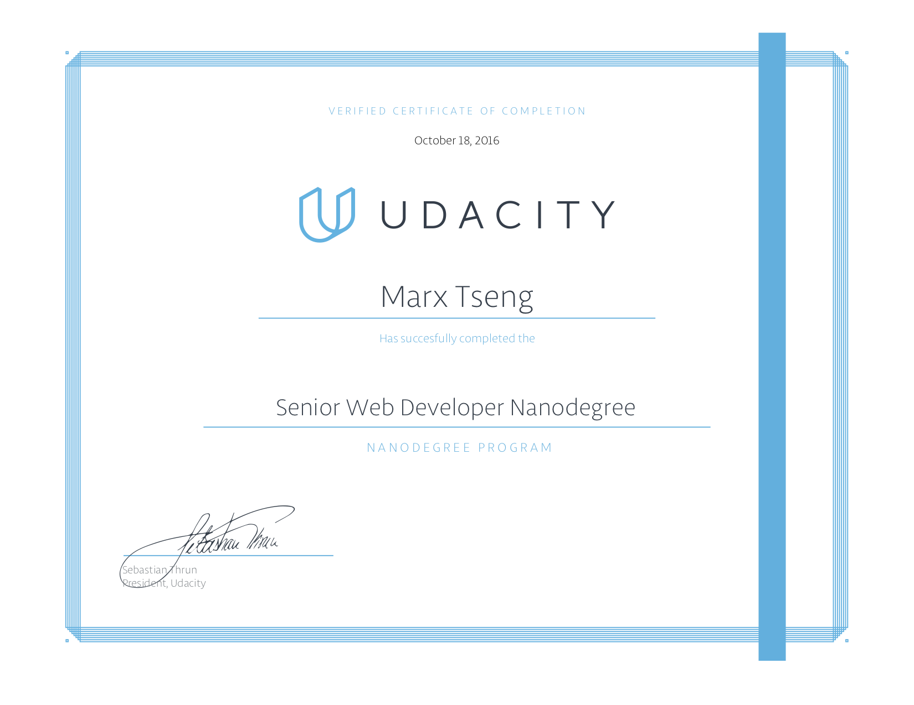
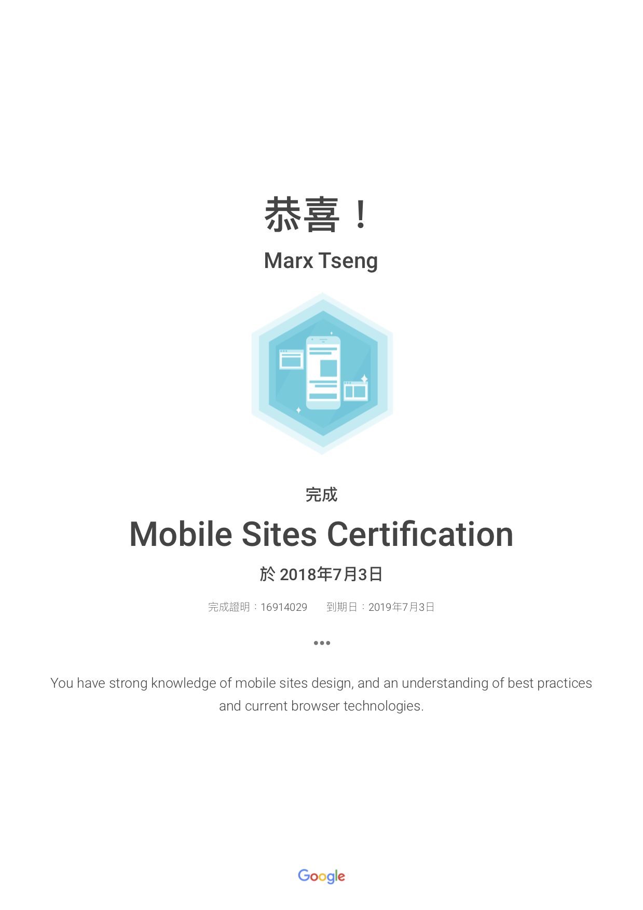

# Marx Tseng — Senior Full-Stack & Mobile Engineer

> **資深全端網站與跨平台行動應用工程師**  
> 個人履歷網站：[https://marxtseng.github.io](https://marxtseng.github.io)

---

## 關於我 (About Me)

本身具備跨領域工程背景，2003 年 6 月（民國 92 年）畢業於**朝陽科技大學營建工程研究所**，碩士研究方向聚焦於**程式設計與演算法應用**。畢業後曾投入營建工程領域，在實務歷練過程中，確立自己對於電腦軟硬體、網路資訊與軟體工程的濃厚熱忱，遂毅然轉換跑道，全心投入資訊工程專業領域。

其後先後完成 **Java 程式設計專班** 及 **行政院第二專長人才培訓班（程式設計師班）** 嚴謹訓練，並考取 **SCJP（Sun Certified Java Programmer）** 與 **MOUS（Microsoft Office User Specialist）專家級認證** 等專業證書。

踏入軟體工程職場後，持續深耕不同領域之技術研發，核心專長為 **Full-Stack Web Development（全端網站開發）** 與 **Mobile App Development（跨平台與原生行動應用開發）**。擅長依據專案特性與業務規模，規劃最適切的前後端技術組合（涵蓋 `React`、`Vue.js`、`Angular`、`Polymer`、`Node.js`、`Ruby on Rails`、`Ruby`、`Java`、`Python`、`Google Cloud Platform`、`Firebase`、`AWS` 等），並結合 Native 與 Hybrid / React Native 架構打造高品質行動應用，持續探索前沿開發平台與工程技術。

---

## 核心技術與系統架構 (Core Competencies & Architecture)

| 領域 | 技術與架構說明 |
| :--- | :--- |
| **自管主機全端架構** *(On-Premises / Self-Hosted)* | 前端採用 `React`、`Vue.js`、`Angular`、`Polymer` 等現代框架；後端運用 `Node.js`、`Ruby on Rails (RoR)` 搭配 `PostgreSQL`、`MongoDB` 資料庫，透過標準化 `RESTful API` 進行前後端分離整合。 |
| **雲端原生架構** *(Cloud-Native Architecture)* | 深度整合 Google Cloud 與 AWS 服務，前端採用 `React`、`Vue.js`、`Angular`、`Polymer`，後端結合 `Google App Engine (GAE)`、`Google Compute Engine / Cloud (GCC)`、`Cloud Datastore (GCD)` 與 `Firebase`，並透過 `Google RESTful API` 串接雲端生態系。 |
| **行動應用開發** *(Mobile App Development)* | 涵蓋 `Android` 與 `iOS` 原生（Native）開發，以及 `React Native` 跨平台開發與既有原生 App 之模組化外掛（Plugin Module）整合架構。 |

---

## 代表專案與產品實績 (Selected Projects)

### 1. [1Campus 智慧校園行動應用 (1Campus App)](https://play.google.com/store/apps/details?id=tw.com.ischool.onecampusmobile)
* **技術架構**：以 iOS / Android Native 原生語法建構底層宿主平台框架，各項業務模組則採用 `React Native` 開發獨立外掛模組（Plugin Architecture），兼顧原生穩定度與跨平台高效率擴充。
* **產品連結**：[Google Play (Android)](https://play.google.com/store/apps/details?id=tw.com.ischool.onecampusmobile) ｜ [App Store (iOS)](https://itunes.apple.com/tw/app/1campus/id1273657906?mt=8)

### 2. [1Campus Classroom 智慧課堂即時互動系統](https://classroom.1campus.net)
* **技術架構**：使用 `React` 開發多端即時同步互動教學平台，串聯教室、教師、學生與智慧機器人助教：
  * **Classroom（教室端）**：可由教師透過手機遠端播放影片、投影片（Google Slides），並即時呈現課堂問答、隨機抽籤與學生投票統計結果。
  * **Teacher（教師端）**：透過行動裝置遠端控制播放內容、發起即時問答與隨機抽人，即時同步狀態至 Classroom 與 Student 端。
  * **Student（學生端）**：隨教師授課內容進行即時互動，如線上問答回覆、投票與接收隨機抽籤通知。
  * **Zenbo（課堂小助理）**：整合 ASUS Zenbo 智慧機器人擔任課堂互動小助理。
* **產品連結**：[https://classroom.1campus.net](https://classroom.1campus.net)

### 3. [1Know 翻轉學習行動應用 (1Know App)](https://play.google.com/store/apps/details?id=com.oneknow.app)
* **技術架構**：採用 `React Native` 開發之數位學習行動應用程式。
* **產品連結**：[Google Play (Android)](https://play.google.com/store/apps/details?id=com.oneknow.app)

### 4. 企業內部 LINE Bot 自動化整合系統
* **專案內容**：串接 LINE Messaging API 開發公司內部專屬 LINE Bot，整合員工上下班打卡、差假申請與日常工作進度回報等功能，提升內部行政與協作效率。

### 5. ASUS Zenbo 智慧機器人互動教學整合開發
* **專案內容**：運用 ASUS Zenbo SDK 設計與開發互動式教學應用程式，打造寓教於樂的智慧教室應用場景。

---

## 開源專案與教育訓練 (Open Source & Technical Training)

* **Udacity Senior Web Developer Nanodegree 專案作品集**：[專案展示與原始碼](https://marxtseng.github.io/Senior-Web-Developer-Nanodegree)
* **Better Development 軟體開發實務教材**：[線上教材](https://marxtseng.github.io/better-development)
* **Google Assistant with Snowboy Hotword Detection**：[GitHub Repository](https://github.com/marxtseng/google-assistant-service-with-snowboy-hotword-detection)

---

## 專業認證 (Certifications)

| 認證名稱 | 發證機構 | 證書預覽與文件 |
| :--- | :--- | :--- |
| **Senior Web Developer Nanodegree** | Udacity (2016.10) | [證書影像](./nd-grad-cert.png) ｜ [PDF 證書](./nd-grad-cert.pdf) |
| **Mobile Sites Certification** | Google Academy for Ads (2018.07) | [證書影像](./Mobile_Sites_Certification_Academy_for_Ads.png) ｜ [PDF 證書](./Mobile_Sites_Certification_Academy_for_Ads.pdf) |
| **SCJP (Sun Certified Java Programmer)** | Sun Microsystems | 專業程式設計師認證 |
| **MOUS (Microsoft Office User Specialist)** | Microsoft | 專家級認證 |

  
  

---

## 外部連結 (Connect)

* **LinkedIn**：[https://www.linkedin.com/in/marxtseng](https://www.linkedin.com/in/marxtseng)
* **GitHub**：[https://github.com/marxtseng](https://github.com/marxtseng)
* **Udacity Profile**：[https://profiles.udacity.com/p/u4552099](https://profiles.udacity.com/p/u4552099)
* **Twitter / X**：[https://twitter.com/marx_tseng](https://twitter.com/marx_tseng)
